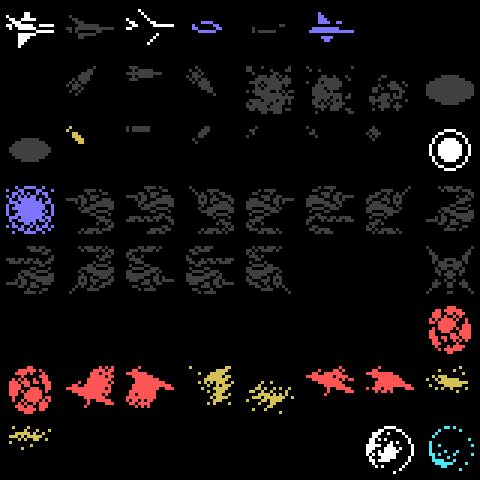
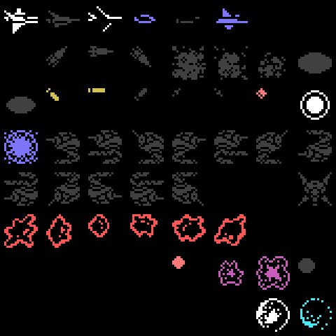
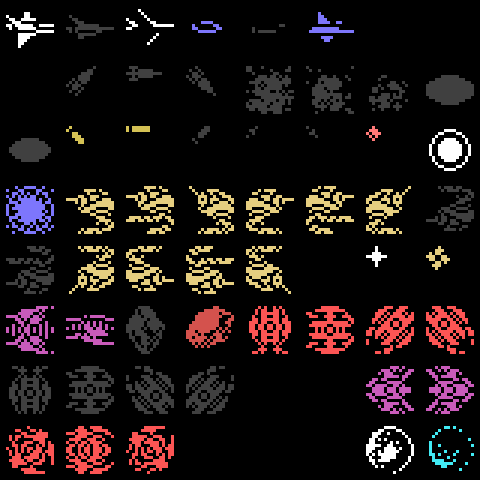
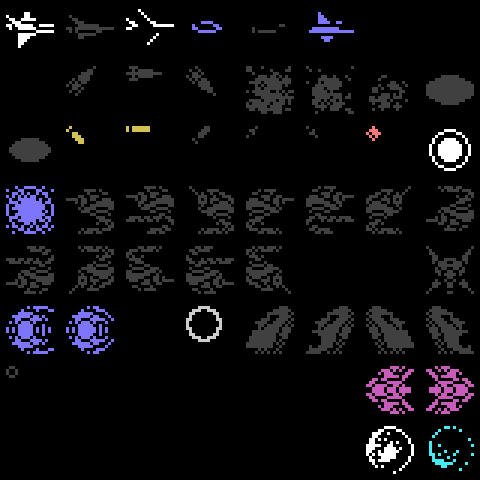
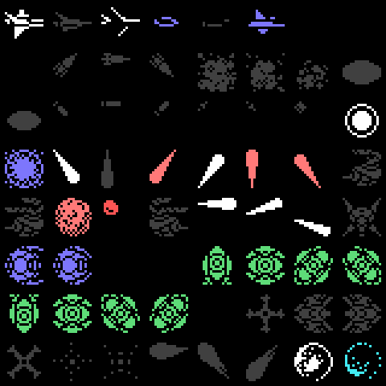
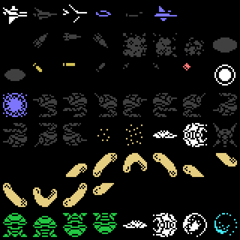
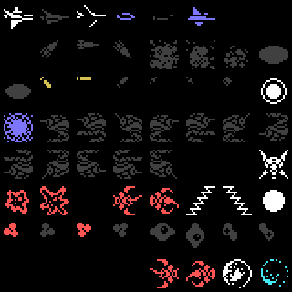
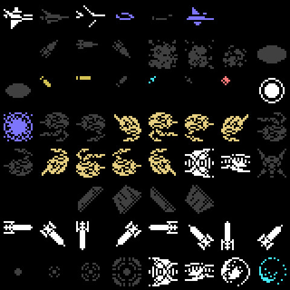
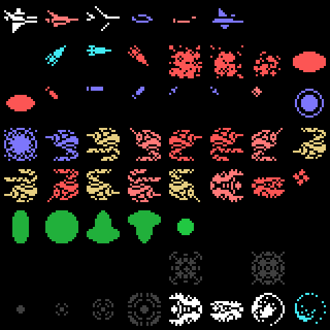
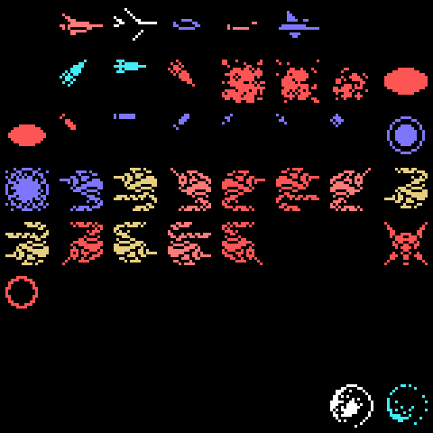

# The enemies

Enemies are 0x40-byte records at `0xE800` (twelve at a time). Their type picks
the routine (table `p01:775C`, 74 types) and the record of its class
(`p19:A489`, 7 bytes per type): whether it is made of sprites or characters and
how many sprites it uses. With more than twelve enemy sprites on screen, the
next one does not appear (`p01:76A9`).

Below, the 64 16 x 16 sprite patterns each stage loads, **from the ROM**
(`tools/sprites.py`, like `p00:4F82`: runs, lists `p14:6EED` and mirrored or
upside-down copies `p14:6FAA`), checked against openMSX's VRAM. The colour is
the one each pattern carries most often in the attribute table while playing
that stage; in dark grey, the ones that did not show up in the game. The boss
ones are loaded separately, when the boss appears (`p00:50FE`).

The first ones are shared: the ship, its shots and missiles, and the
explosions. Pattern 22 is changed by the game every 8 frames (`p02:8331`).

Some enemies are not sprites but characters drawn into the scenery: the sun of
stage 1 or some of stage 2 (`p01:79C3`).
