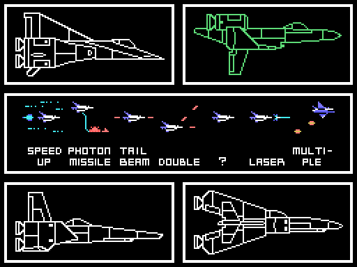
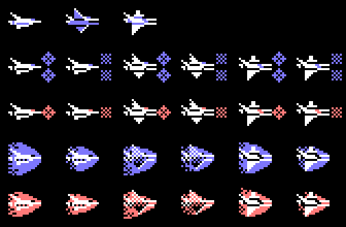
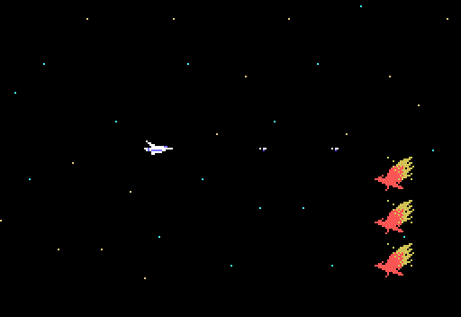

# The ship

Before each game you choose **the ship, the shield and the options**
(`p26:680C`). There are four ships, and each one changes what the weapon bar
gives.

*The whole choice, from a game in openMSX.*

## The poses

*Drawn from the ROM (`tools/nave.py`): still, going up and going down, without
a shield, with the front one and with the big one, with 2 or more hits left and
with one. Each shield has two frames that swap every 4 frames.*

The ship is two sprites: a white one and a blue one on top (`p04:8091`). The
patterns are loaded with the runs at `p14:7055` and change with the shield
(`p00:5019`).

## The bar

Each capsule moves the mark one slot (`p01:6A01`); button 2 buys the marked
one (`p04:92D8`). Each ship has its own purchase table (`p04:931E`), and how
far each slot can go up is set by the **secret weapon** (`p04:94D0`).

| Slot | Ship 0 | Ship 1 | Ship 2 | Ship 3 |
|---|---|---|---|---|
| 1. SPEED UP | 7 levels | same | same | same |
| 2. MISSILE | MISSILE | PHOTON MISSILE | NAPALM MISSILE | 2WAY MISSILE |
| 3. TRAIL BEAM | TAIL BEAM and BEAM | same | same | same |
| 4. DOUBLE | UP DOUBLE, DOWN DOUBLE | same | same | same |
| 5. ? | UP LASER, DOWN LASER | same | same | same |
| 6. LASER | LASER, METEOR, SCREW | LASER, TWINKLE, SCREW | RIPPLE, FIRE BLASTER, EXTEND BLASTER | RIPPLE, FIRE BLASTER, VECTOR |
| 7. MULTIPLE | two options | same | same | same |
| 8. shield | SHIELD or FORCE FIELD, as chosen | | | |

The names are the ones on the bar: 36 letter patterns (`p14:646C`), picked
by ship and by level (`p04:95F9`).

Without the secret weapon, slot 5 cannot be bought and slot 6 only gives its
first laser. Each secret weapon entrance raises it one level, up to 7
(`p26:6EAD`):

| Level | What opens |
|---|---|
| 1 | the second laser of slot 6 |
| 2 | the third |
| 3 | UP LASER (slot 5) |
| 4 | DOWN LASER |
| 5 | DOWN DOUBLE |
| 6 | the second missile (HOWK) |
| 7 | GUIDED MISSILE |

Buying BEAM or DOUBLE clears the laser, and buying the laser removes BEAM and
DOUBLE (`p04:93BD`, `p04:9461`).

## The weapons firing

Each one is a game in openMSX: the chosen ship, the slot marked and button 2,
as a player would do it; for the secret weapon ones, the level set by hand.
Checked in each game that the weapon left in RAM (`0xE630-0xE632`) is the one
in the table.

### The shot and the missiles

Ship 3 shows 2WAY MISSILE on the bar, but the table at `p04:9391` gives it the
same missile as ship 0 (0x10), and in openMSX it fires the same.

With the secret weapon at 6 a second missile (HOWK) can be bought, and at 7 the
third, GUIDED MISSILE, the same for all four ships:

### TRAIL BEAM and DOUBLE

### Slot 5

### The lasers

### The options and the shields

SHIELD takes 10 hits and FORCE FIELD 5 (`p04:949A`); with the EXPAND password,
twice as many (`p04:94A2`).
