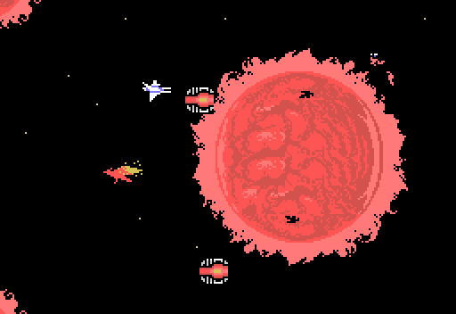
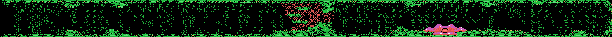
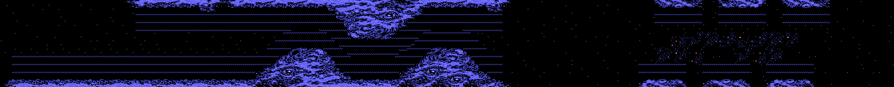
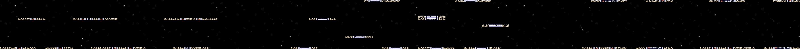
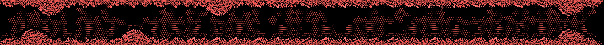
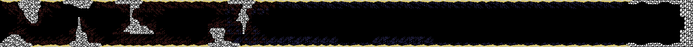
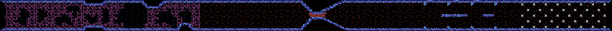
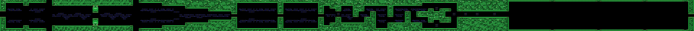
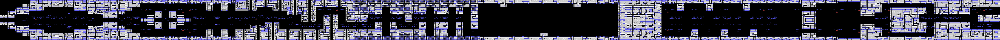
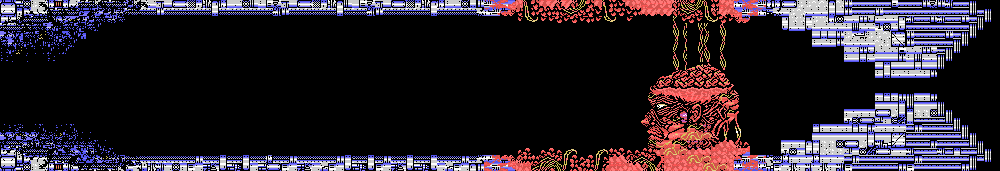

# Las fases

**Once fases**, pero no siempre en fila: tras la 9 un ordenador de a bordo mira si se han
cogido tres entradas secretas y, si falta alguna, manda de vuelta a la 5, la 7
o la 8. La 10 y la 11 solo se ven con las tres.

Los recorridos están **dibujados desde los bytes de la ROM** (`tools/dibuja.py`)
y cotejados con openMSX: en 9 fases y 7 momentos de cada una, todas las casillas
de la pantalla son las del mapa y los caracteres, los mismos.

## El orden

| Al acabar | Pasa a | Dónde |
|---|---|---|
| 1, 2, 5, 6, 7, 8, 10 | la siguiente | `p00:45B3` |
| 3 y 4 | una escena en el ordenador de a bordo y la siguiente | `p00:45CA`, `p27:814D` |
| 9 | el ordenador de a bordo | `p00:45E3`, `p26:7EC5` |
| 11 | el final | `p00:4599` |

En el ordenador de a bordo se encienden tres marcas, una por entrada secreta: son tres
mapas, rojo, azul y verde (`0xE393-0xE395`, `p26:7E2A`). Con las tres, la fase siguiente es la 10
(`p26:7F7A`). Si falta alguna (`p26:7FC8`):

- sin la marca de la fase 5, se vuelve a la 5;
- sin la de la 7, a la 7;
- sin la de la 8, a la 8.

Desde entonces, cada fase que se acaba lleva otra vez al ordenador de a bordo
(`0xE398`), hasta tener las tres.

## Las entradas secretas

Son casillas escondidas en el decorado: si la nave pasa por ellas, el juego
para la fase y enseña otra pantalla (el estado 9, `p26:6CA4`). Cada fase tiene
su lista (`p19:A3C8`): la posición del scroll, el tipo y la altura. Cada una
tiene **cuatro sitios posibles**, y la partida usa uno: al elegir la nave, el
juego guarda la cuenta de cuadros y 3 (`p26:6819`, `0xE381`).

| Fase | Tipo | Qué da |
|---|---|---|
| 2, 3, 5, 6, 7 | 1 a 5 | un arma secreta (`p26:6E29`) |
| 5, 7, 8 | 8, 9 y 0x0A | las tres marcas del ordenador de a bordo (`p26:7D46`) |
| 9 | 0x0C | desde ahí las entradas se ven (`p02:8192`) |
| 10 | 0x0B | el final con un paso más (`p27:8786`) |

## Cómo se monta el recorrido

El scroll es horizontal y va de carácter en carácter. Cada columna nueva la
mete `p00:5345` en el búfer de `0xC400`, de 64 caracteres de ancho; las 32 de la
izquierda son la pantalla.

- El mapa de cada fase está en `p24:946F`: seis bytes por columna, uno por
  bloque de 4 x 4 caracteres; el último bloque solo pone dos filas (22 filas en
  total).
- Los bloques 0-3 son comunes (`p23:6021`); los demás son de la fase
  (`p23:5FFE`): unos de 16 bytes y, detrás, otros de 8 (dos filas).
- Solo hay mapa entre dos posiciones del scroll de cada fase (`p19:A90F`);
  fuera, el espacio vacío. **La 1 y la 4 no tienen mapa**: el sol de la 1 son
  enemigos hechos de caracteres, y la 4 es una fila de jefes.
- En las fases 2, 3, 5, 8, 9 y 10 los caracteres cambian a mitad de camino
  (`p00:51EE`), y en las 3, 6, 7, 8, 9 y 10 algunos se mueven solos: el agua de
  la 3, por ejemplo (`p02:835A`).

### Fase 1

*Sin mapa: el sol rojo son caracteres que dibuja el código.*

### Fase 2

*352 columnas.*

### Fase 3

*224 columnas. Si la nave entra en uno de los remolinos, vuelve al principio de
la fase (`p02:85BB`).*

### Fase 4

Sin mapa: cuatro jefes seguidos (`p01:6243`). Están en [Los jefes](LOS-JEFES.html).

### Fases 5 a 11

*352, 288, 320, 416, 480, 544 y 128 columnas.*

## La música de cada fase

`p00:5759` mira la tabla `p00:5792`: pares de pieza y posición del scroll. Al
llegar a la posición, la música se funde y entra la siguiente.

| Fase | Al empezar | Durante | Al final |
|---|---|---|---|
| 1 | - | 0x06 | 0x05 |
| 2 | - | 0x07 | 0x05 |
| 3 | 0x04 | 0x08 | 0x05 |
| 4 | 0x0A | - | 0x09, 0x0A, 0x0B |
| 5 | 0x04 | 0x0C | 0x05 |
| 6 | 0x04 | 0x44 | 0x05 |
| 7 | 0x04 | 0x45 | 0x05 |
| 8 | 0x04 | 0x46 | 0x05 |
| 9 | 0x04 | 0x0D | 0x05 |
| 10 | - | 0x47 | 0x05 |
| 11 | - | 0x0E | - |

Se oyen en [La música](LA-MUSICA.html).
