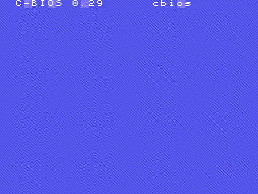
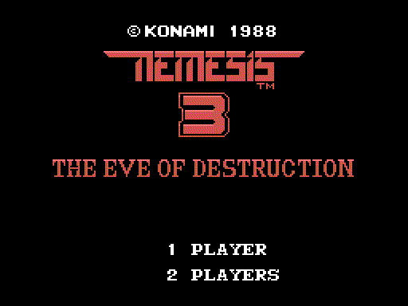
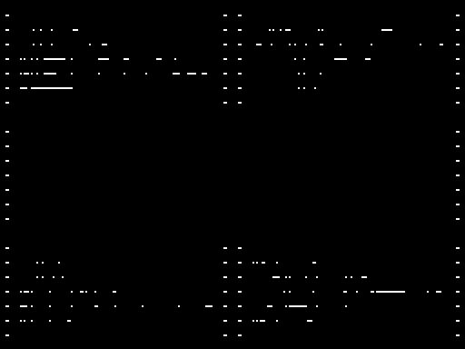
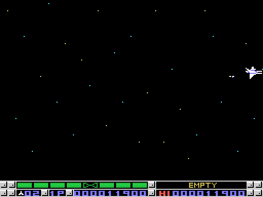
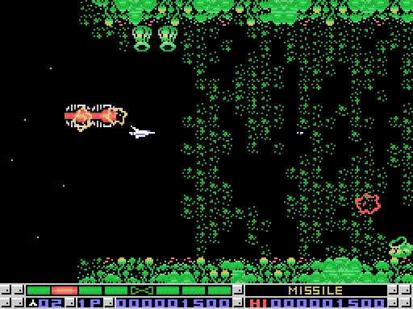
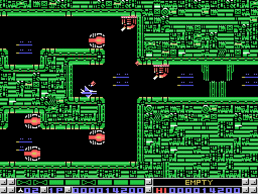
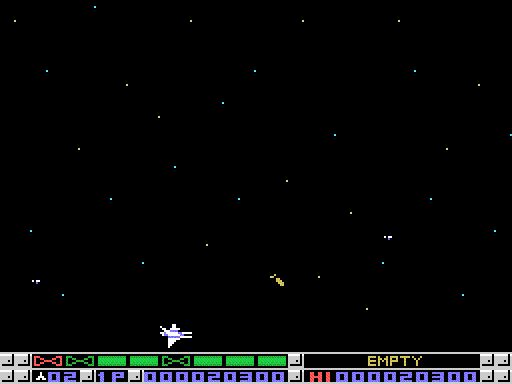
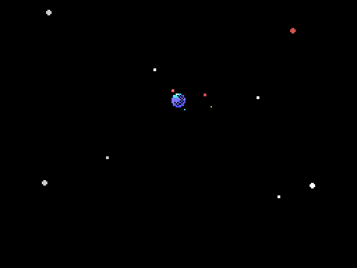
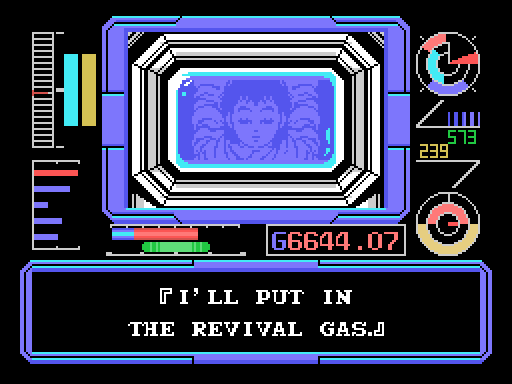
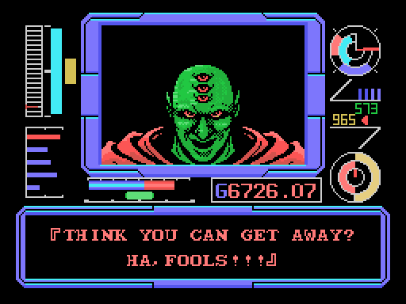

# Las secuencias

Las animaciones son **la VRAM de cada cuadro de una partida en openMSX**,
pintada como la pinta el TMS9918 (`tools/anima.py`). Las fijas, el mismo
cuadro a doble tamaño.

## La presentación

*Del logo de Konami al título, 8 segundos.*

Si nadie toca nada, a los 10 segundos empieza la historia, y tras ella una
demostración de las fases 1 a 3 (`p19:B568`), con la nave invencible.

## La historia

*La historia entera, 3 minutos y 18 segundos, con un cuadro de cada seis.*

Primero las tres guerras de las entregas anteriores, contra Bacterion, Venom y
Salamander, con escenas en pequeño. Luego la
cronología del planeta Nemesis, la nave VIXEN y sus cuatro clases, el
ordenador GAUDIE y el piloto, David Burton. El texto está en
[Los textos](LOS-TEXTOS.html); la música, en dos piezas (0x4A y 0x3E).

## La elección

*La nave, la barra de armas que corresponde a cada una, el escudo y las
opciones. Ver [La nave](LA-NAVE.html).*

## Entre fases y las entradas secretas

Las pantallas del ordenador de a bordo de la VIXEN (estado 8 entre fases y estado 9 en las
entradas secretas, `p26:6CA4`). Para las de las
entradas, la entrada se puso delante de la nave en `0xE7E0`, que es lo que
mira la nave al chocar (`p02:812D`).

*Tras la fase 3: THE MOVEMENT OF THE BACTERIONS IS ODD (`p27:814D`).*

*Una entrada de arma secreta (tipo 1): el plano de la nave se dibuja y sale el
láser que se abre, aquí METEOR LASER (`p26:6E29`).*

*La entrada del tipo 8: HERE'S A RED MAP. Las tres marcas del ordenador de a bordo son
tres mapas, rojo, azul y verde, y hacen falta los tres (`p26:7D46`).*

*La entrada del tipo 0x0C, en la fase 9: I'VE FOUND SOME KIND OF A
EXTRA-SENSORY DEVICE. Desde entonces las entradas secretas se ven.*

*Tras la fase 9: HERE'S THE ASSEMBLED MAP. Si falta uno: WE STILL NEED ONE MAP.
I'LL GO BACK AND GET IT, y el juego vuelve a la fase de ese mapa
(`p26:7FC8`).*

## El final

*El rescate de James Burton y la vuelta, 94 segundos.*

*EMERGENCY!!, el mensaje de Venom y la cronología, 2 minutos y 19 segundos.*

Tras la cronología sale EXTEND PLAY / F5: con F5 la partida sigue en otra
vuelta.
