# Los jefes

Cada fase con jefe lo saca al llegar al final del scroll (`p01:6128`, con la
tabla `p01:6111`, una entrada por fase); el número va en `0xE440` y su código lo elige la tabla de
`p04:9D9E`. Las fotos son de partidas en openMSX con la nave inmortal: el
cuadro de la VRAM unos segundos después de aparecer el jefe, pintado como lo
pinta el TMS9918. Los nombres no están en la ROM; aquí van por fase y número.

| Fase | Jefe | |
|---|---|---|
| 1 | 0x06 | 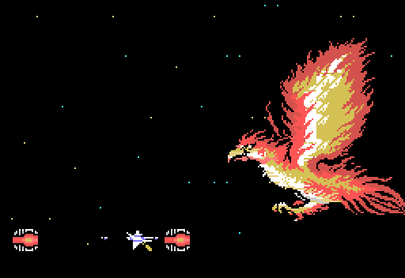 |
| 2 | 0x07 | 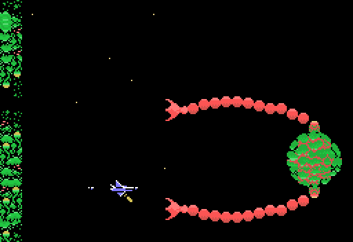 |
| 3 | - | la fase acaba sin jefe |
| 4 | 0x0B, 0x01, 0x03 y 0x04 | abajo |
| 5 | 0x08 | 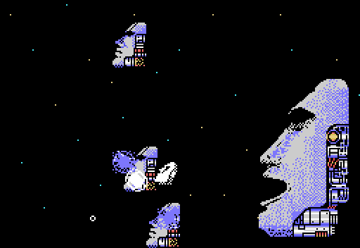 |
| 6 | 0x09 | 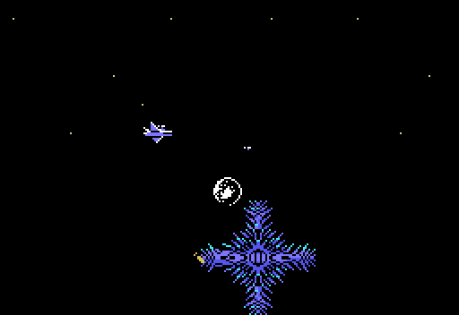 |
| 7 | 0x0E | 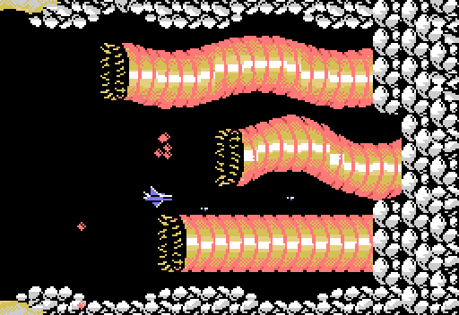 |
| 8 | 0x0C | 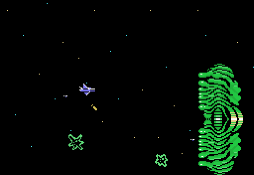 |
| 9 | 0x0D | 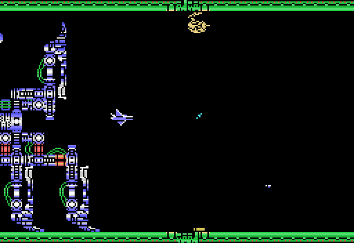 |
| 10 | 0x0F | 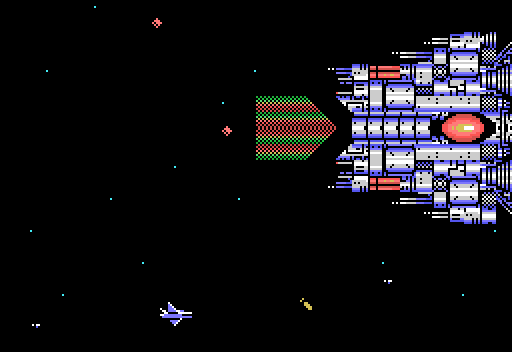 |
| 11 | 0x10 | 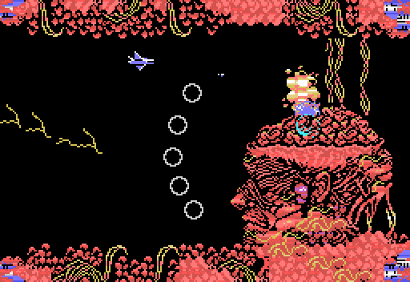 |

## La fase 4

No tiene mapa: es una fila de cuatro jefes, uno detrás de otro (`p01:6243`),
cada uno con su música (0x0B, 0x09 y 0x0A; ver [La música](LA-MUSICA.html)).

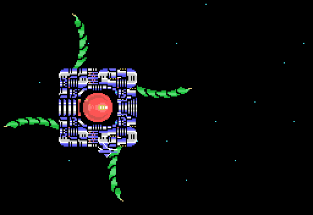
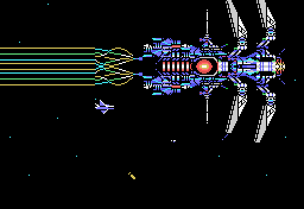
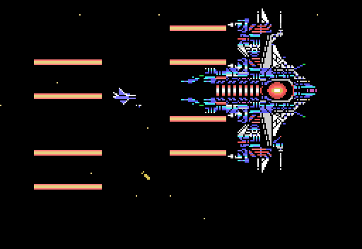
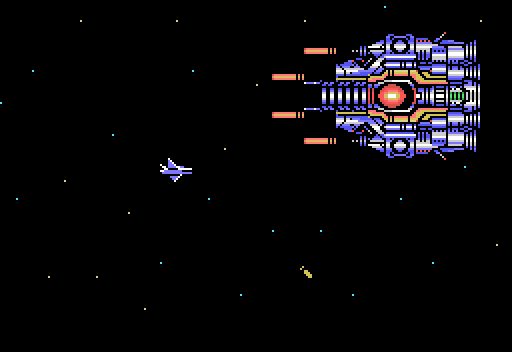

*Con el disparo automático el 0x0B no cae, así que para los otros tres se puso
a mano, al entrar en la fase, el contador de jefes de la fase 4 (`0xE37C`, que
`p00:45BB` pone a cero al acabar la 3).*

Las vidas del jefe van en `0xEC12`; su dibujo, por partes de caracteres en el
búfer (`0xEC00-0xEC7F`, cuatro fichas de 0x20 bytes).
